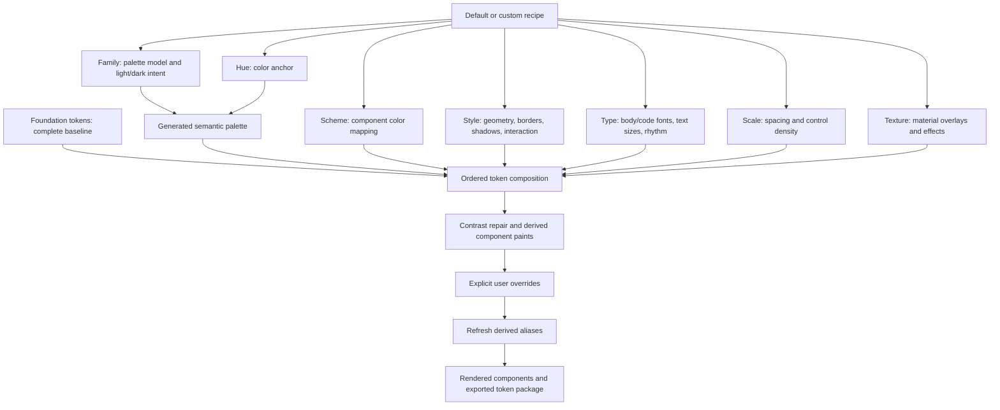

# Theme Architecture

A default theme is a named recipe selecting one option from each of seven modules. The recipe is the identity: no additional styling is activated by the default theme name. Custom themes use the same composition process, plus explicit property edits.

## Seven-module model

The UI calls typography **Type**; its stable recipe key is `typography`. The [generated catalog](THEME_PRESET_MAP.md) records every default recipe and every Type option's exact font stacks.

## What Scheme does

Family and Hue generate the available semantic colors. Scheme chooses **where those colors appear**: for example, whether controls use neutral surfaces or accent fills, and which foreground/border accompanies that treatment. Scheme is not another name for light/dark mode, nor should it select fonts or geometry.

The intended reusable boundary is semantic mapping: reference `--ds-accent`, `--ds-text`, and surface tokens rather than duplicating a palette in component paint values. `standard` is the baseline for family/hue-driven composition. A Scheme can still use color mixes and gradients while following those semantic colors.

### Current implementation exceptions

Some authored Schemes also modify the semantic palette. These are compatibility exceptions, not an additional layer or hidden theme override:

| Scheme | Palette overlap |
|---|---|
| `industrial-lime` | Fixed text and accent colors |
| `eva-unit01`, `saturn-alloy` | Fixed surfaces, text, and accent colors |
| `rr4-sprint` | Fixed page background |
| `holo-nocturne`, `oilslick-organic` | Fixed surface colors |
| `amber-glow`, `eva-wire-alert`, `neon-grid-signal` | Text colors derived from accent mixes |

Other Schemes contain literal component paints too; absence from this table does not guarantee every component will follow Hue. The old scheme audit allowlist is not a complete inventory of these overlaps. A subsequent migration should move fixed palette intent into Family options and convert component paints to semantic references, with appearance and contrast comparisons before changing defaults. This documentation update preserves those appearances.

## Type identity and fonts

The catalog contains twelve font choices, each with a distinct preferred body face, a paired code stack, five explicit text sizes, and line height. Labels use the font name alone. Minor fallback, size, or line-height changes do not justify additional preset options; use property edits for those adjustments.

Consolidation groups the former Inter variations into `precision-ui`, Space Mono variations into `terminal-glow`, Aptos/Segoe UI into `neutral-ui`, Tahoma/Verdana portal treatments into `portal-ui`, and the duplicate OCR/condensed EVA treatments into `eva-digital` and `eva-unit-display`. The remaining options retain distinct faces: Helvetica Neue, Eurostile, Baloo 2, Sora, Outfit, and Arial Black. Surviving IDs are unchanged. The [generated retired-ID table](THEME_PRESET_MAP.md#retired-type-ids) is the complete migration map.

Defaults now directly select consolidated options, so some default text sizes/rhythm and code-font pairings change. Imported exports and saved drafts map retired IDs to current selections. When a token snapshot is present, the existing compatibility mechanism retains the old appearance as explicit overrides. Without a snapshot, aliases adopt the current Type values and retain explicit edits. Reset clears those compatibility overrides and adopts the consolidated option; manual edits still survive subsequent module changes.

A declared font stack is not an embedded font asset. The browser uses the first available face. The current package imports Inter and Space Mono; other preferred faces require installation or loading by the consuming app, subject to their licenses. Style still owns some label casing/tracking; moving those into Type would require a separate compatibility migration.

## Resolution order used by Studio

1. Start with the complete `css/tokens.css` foundation, independent of the previously selected theme.
2. Generate Family + Hue semantic colors and component defaults.
3. Apply Scheme.
4. Apply Style.
5. Apply Type (`typography`).
6. Apply Scale.
7. Apply Texture.
8. Repair supported foreground/background contrast pairs and derive component paint aliases.
9. Apply explicit user overrides, then refresh derived aliases. Generated paint aliases are recomputed from their source tokens rather than treated as independent editable inputs.

Later modules win when they author the same property. That mechanism explains legacy overlaps; it does not make overlapping responsibilities desirable. Resetting edits is a separate user action, not a prerequisite for changing modules. Exports contain the resolved token values; recipe packages additionally retain recipe and overrides for editable reconstruction.

## Modules versus editor property groups

The seven modules are reusable inputs. Editor groups (Semantic Colors, Typography, Density/Layout, Geometry, Surfaces, Buttons/Inputs, Native Controls, Chips/Scrollbars, Motion, and Layers) organize individual properties for inspection and editing. They are not extra recipe modules. Properties without a module-specific value remain covered by the foundation, and edits to those properties are retained as overrides.
